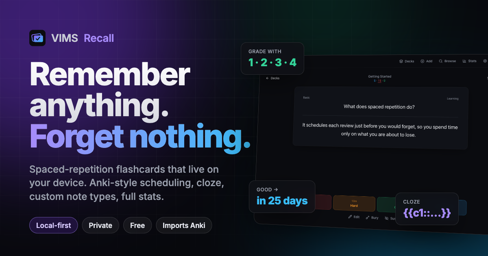

# VIMS Recall

**Live:** https://aeventures.github.io/vims-recall/

Local-first spaced-repetition flashcards — our own take on Anki. Everything lives in the browser (IndexedDB); nothing leaves the device.

## Run

```bash
pnpm install
pnpm dev          # http://localhost:5173
pnpm test         # vitest (scheduler, templates, collection, import/export, apkg)
pnpm typecheck
pnpm build        # production PWA in dist/
```

## What's in V1

- Decks with `Parent::Child` nesting, per-deck option presets (daily limits, learning/relearning steps, ease, intervals, lapses, leech handling, bury siblings).
- Note types: Basic, Basic + reversed, Cloze, and a full editor for fields, card templates and CSS. Template syntax: `{{Field}}`, `{{cloze:Field}}`, `{{hint:Field}}`, `{{text:Field}}`, `{{#Field}}…{{/Field}}`, `{{^Field}}…{{/Field}}`, `{{FrontSide}}`, `{{Tags}}`, `{{Deck}}`, `{{Card}}`.
- Anki-style SM-2 scheduler (`src/domain/scheduler.ts`): learning steps, graduating/easy intervals, ease factor with 130% floor, hard/good/easy interval formulas with overdue bonus, interval fuzz, max interval, relearning, leech detection, learn-ahead window, 4am day rollover.
- Study screen: Again/Hard/Good/Easy with interval previews, undo, bury, suspend, inline edit. Keys: `space`/`enter` show/Good, `1-4` grade, `z` undo, `e` edit, `-` bury, `!` suspend, `o` options.
- Browser with Anki search syntax: `deck:` `tag:` `note:` `card:` `is:new|learn|review|due|suspended|buried` `flag:` `prop:ivl>30` `added:7` `-term` `"phrase"`. Bulk suspend / forget / set due / move / delete.
- Stats: today, streak, 30-day forecast, 30-day history, card counts, true retention, ease histogram.
- Import: Anki `.apkg` (export from Anki with “Support older Anki versions”), tab/CSV text. Export: full JSON backup (merge or replace restore), deck → text.

## Layout

```
src/domain   pure logic: types (Zod), scheduler, templates/cloze, stats, time
src/data     Dexie database, Collection service, search, import/export, apkg
src/pages    Decks, Study, Add, Browse, Stats, Settings, NoteTypes
src/components UI primitives (shadcn-style), CardRenderer, editors, dialogs
```

## Not yet

Sync/accounts, FSRS, filtered decks, type-in-answer, media upload UI (renderer already resolves stored media), Electron shell.
